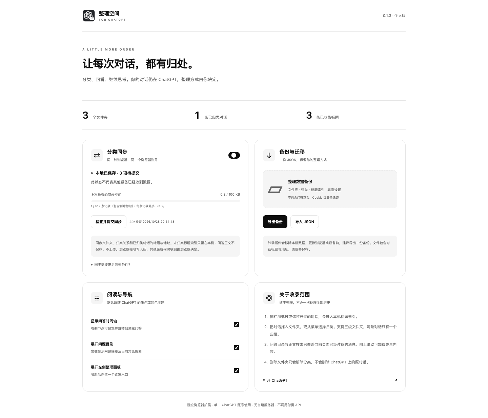
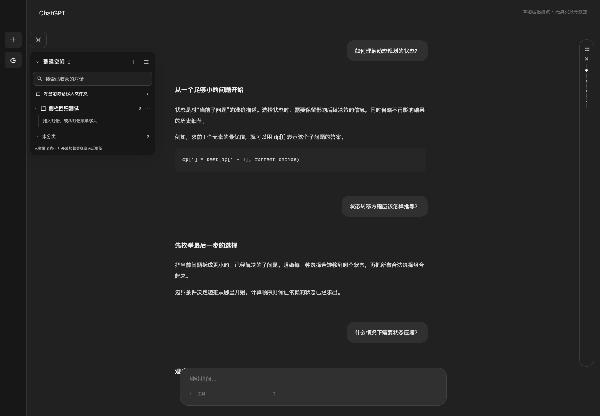
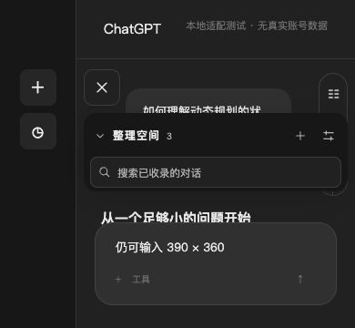
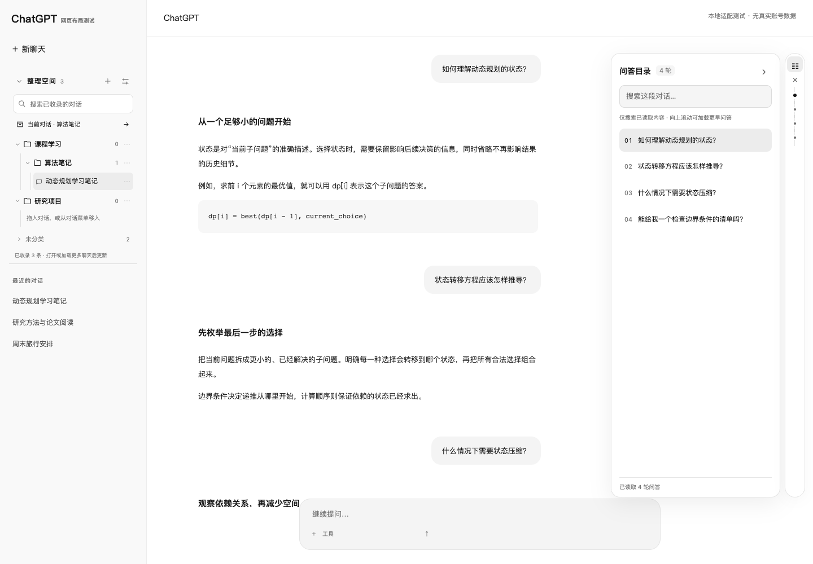
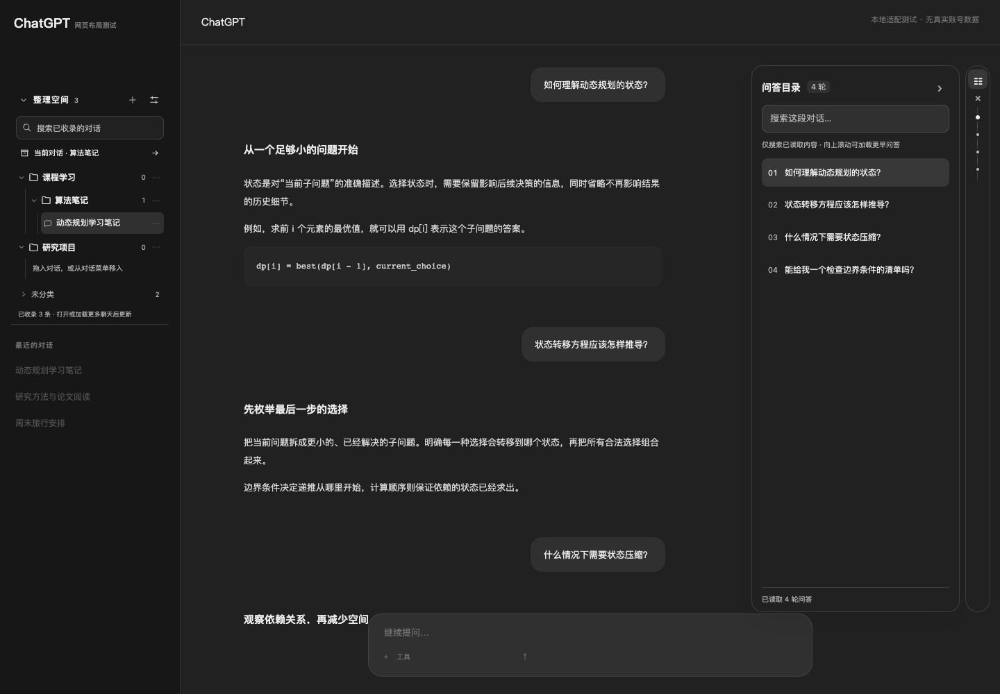
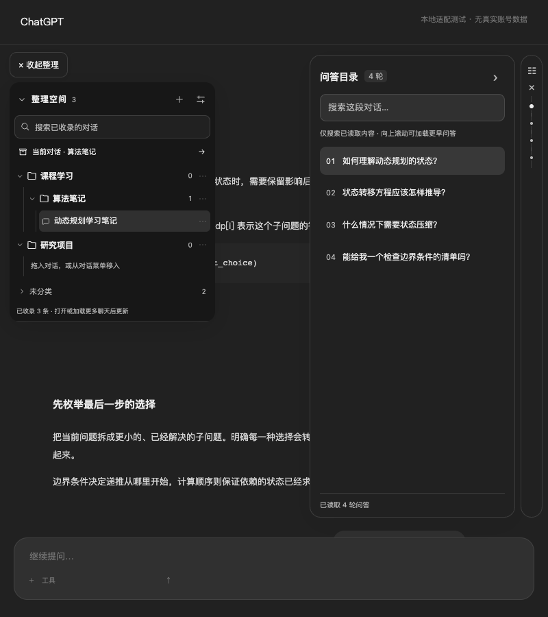
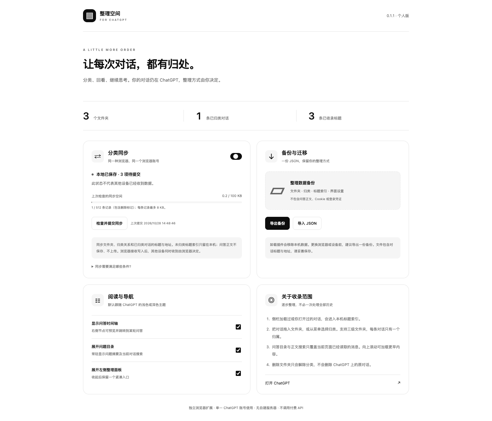

# v0.1.3 图标更新与验证记录

日期：2026-10-28（Asia/Shanghai）。扩展 ID：`agkjfdlffbijhaogmnekcfpkddnfihib`。

## v0.1.3 图标更新

- 使用内置 imagegen 生成交织结形与文件夹角标组合的新 Logo，接入浏览器工具栏、扩展图标、设置页品牌图和 favicon。
- 原图与生成提示词保存于 `assets/branding/`；16 / 32 / 48 / 128 px 图标保存于 `assets/icons/`，构建直接复制，避免再次生成旧图标。另提供 300 px 商店素材。
- 设置页版本号改为读取 manifest，避免更新后仍显示旧版本。
- TypeScript 与生产构建通过；校验 PNG 尺寸、透明通道、manifest 引用以及 ZIP 与源图标一致。内容脚本和后台脚本哈希与 v0.1.2 一致，本轮未重复数据层测试。
- Edge 156.0.4314.42 现有界面回归场景 1 / 1 通过；已查看设置页截图，确认新图标与 0.1.3 版本显示正常。真实 ChatGPT 登录态与双设备同步的验证边界保持不变。



## v0.1.2 侧栏修复

- 修复原生侧栏收起后，「整理」浮动按钮覆盖新聊天、历史图标的问题。入口改为 40 px 方形文件夹图标，保留悬停提示与无障碍名称，配色继续继承网页。
- 入口和面板根据可见原生侧栏的右边界定位；监听侧栏宽度和过渡结束，展开原生侧栏时恢复嵌入式面板。
- 新增回归场景在旧构建上复现：点击原生新聊天按钮失败，浏览器报告插件浮层拦截了点击。修复后通过。
- TypeScript / 生产构建及 34 项单元测试通过；Chrome for Testing 156.0.8078.4、Edge 156.0.4314.42 各 2 项界面回归场景通过。范围包括 64 / 84 px 图标栏、宽度动画、展开收起、深浅主题、800 / 390 px 窄窗口，以及 390 × 360 的短视口。
- 检查入口和面板不覆盖原生图标栏、面板不超出视口，测试中的底部输入框仍可编辑。验证仍基于本地模拟页面，不扩大真实网站或双设备同步的兼容性结论。





## v0.1.1 配色更新

- 插件新增面板优先继承 ChatGPT 的页面颜色变量；没有变量时使用中性灰白 / 深灰回退色。
- 去掉自定义绿色强调色；文件夹、时间轴、浮动按钮、提示和独立设置页都采用中性配色。
- 不给原页面的背景、文字或消息气泡写入颜色；功能、分类数据结构和扩展 ID 保持不变。
- TypeScript 与生产构建通过。复用已有 Chromium 浏览器场景验证拖拽、子目录、浅深主题、窄屏和设置页，1 / 1 通过，并查看更新后的截图。
- 本次是样式调整，未新增测试，也未重复执行全部数据层或双浏览器测试。下表为 v0.1.0 已完成的功能验证记录。

## v0.1.0 功能验证记录

| 验证项 | 结果 | 环境与范围 |
| --- | --- | --- |
| TypeScript 与生产构建 | 通过 | Node.js 24.15.0；生成 MV3 后台、内容脚本和设置页 |
| 数据、同步与 DOM 适配单元测试 | 34 / 34 通过 | Vitest；fake-indexeddb；jsdom |
| Chrome for Testing 156.0.8078.4 | 4 / 4 场景通过 | macOS，真实加载 dist，使用本地 ChatGPT DOM fixture |
| Microsoft Edge 156.0.4314.42 | 4 / 4 场景通过 | macOS，独立测试配置，真实加载 dist，使用相同本地 fixture |
| 界面检查 | 已查看截图 | 浅色、深色、800 px 窄窗口、设置页 |

浏览器场景覆盖：

1. 创建文件夹、归类、标题搜索、刷新持久化、跨标签重命名、实际点击打开设置页、备份下载与合并、无效备份拒绝、删除分类保留原聊天链接。
2. 时间轴预览、回答正文搜索、真实滚动定位、流式更新、编辑问题、无刷新切换聊天以及原生输入框仍可编辑。
3. 原侧栏链接拖放、子文件夹、深浅主题、宽屏目录预留正文空间、窄屏浮动入口、恢复宽屏。
4. 100 轮已挂载问答中保留时间轴与目录滚动位置；流式更新保持预览；卸载历史 DOM 后不保留无效跳转目标。

单元测试另覆盖：三级限制、事务并发与回滚、导入重复 ID / 循环 / 非法 URL、删除标记、乱序同步引用、离线冲突收敛、配额与限流、本地保存后的调度失败、持久重试、远端新标题更新本地索引。

## 验证边界

- **真实 ChatGPT 登录态页面：未验证。** 测试使用 `tests/e2e/fixture.ts` 提供的本地页面，拦截 ChatGPT 地址并返回模拟 DOM，没有访问真实账号或发送聊天。它验证的是扩展构建、浏览器运行与已知 DOM 结构下的行为，不能证明所有网站版本兼容。
- **Chrome ↔ Chrome、Edge ↔ Edge 的真实双设备账号同步：未验证。** 同步合并、失败恢复和本机浏览器存储调用已有测试，但未验证浏览器云服务把数据送达另一设备。
- **Chrome 与 Edge 互相同步：不支持。** 通过 JSON 备份迁移。
- **Safari、Firefox、手机端：不在第一版范围。**
- 问答目录只涵盖当前读取且仍能定位的消息；未分类标题索引不参与账号同步。

真实环境验收步骤见 [手动验收清单](manual-testing.md)。测试截图没有真实账号数据，不能作为网站真实兼容性的证明。

## v0.1.1 界面预览









## 复现

```sh
npm ci
npx playwright install chromium
npm run build
npm test
npm run test:e2e
E2E_BROWSER=edge npm run test:e2e
```

Edge 测试需要系统已安装 Microsoft Edge；测试自动创建临时用户配置，不使用日常浏览器的登录信息。正式安装包中不包含测试 fixture 或浏览器自动化工具。
